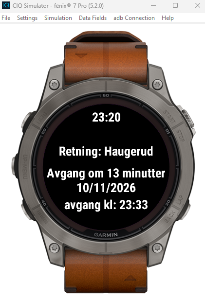
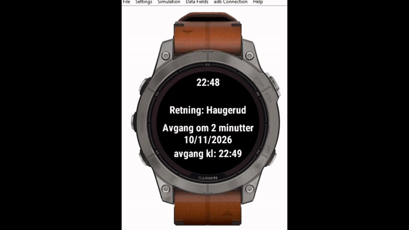

# Perrong
A Garmin watch application that shows a live countdown to the next public transport departure from a Norwegian stop, so you can check your bus at a glance without pulling out your phone.

## Demo

## Features
- Real-time departures from Entur's Journey Planner.
- Countdown in minutes that automatically switches to seconds when the departure is within its last minute.
- Automatically shows the next departure when the current one leaves.
- Available in Norwegian, with further localizations planned.

## Technology
Written in Monkey C using Garmin's Connect IQ SDK. Departure data comes from Entur's GraphQL API (Journey Planner v3).

## How it works
On launch, the application sends a GraphQL query to Entur for the stop's upcoming departures and parses them into a list of trips.
A timer manager works out the exact seconds left to the current trip. A refresh timer updates the display every 20 seconds to keep the visuals current without taxing the device. At the one-minute mark it switches to a per-second countdown, and when the countdown reaches zero the app advances to the next trip.

## Run it
1. Install the Connect IQ SDK (API 3.2.0+) and the Monkey C extension provided by Garmin for VS Code.
2. Open the project and run **Monkey C: Run** or the shortcut **CTRL + F5** (currently only tested on Fenix 7 Pro devices).

## Status / next steps
Working prototype, with a currently hardcoded stop.
- [ ] Let user choose their stop in app settings
- [ ] Fetch new departures when the list is exhausted
- [ ] Clear screen states for loading / no departures / no connection
- [ ] Move display UI formatting into a dedicated class
- [ ] Improve UI visuals and reduce clutter
